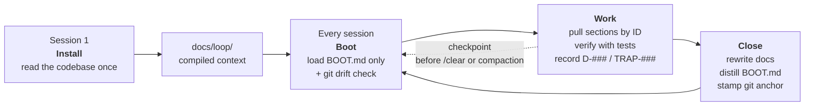

<p align="center">
  
</p>

<p align="center">
  <a href="LICENSE"></a>
  
  <a href="https://github.com/rehaan299/Loop_Engineering/actions/workflows/ci.yml"></a>
  
  
  
</p>

<p align="center">
  <b>Your agent reads the codebase properly once.</b><br>
  Every session after that boots from one small file and pulls the rest by ID.<br>
  Same project, any model, any tool, three weeks later: it picks up exactly where it left off.
</p>

<p align="center">
  <a href="#install">Install</a> ·
  <a href="#how-it-works">How it works</a> ·
  <a href="#whats-new-in-v4">What's new in v4</a> ·
  <a href="#the-cli">CLI</a> ·
  <a href="#why-tiered-context">Why tiered</a> ·
  <a href="#upgrading-from-v3">Upgrade from v3</a>
</p>

---

## Install

Pick the line for the tool you use. Each one takes under a minute.

### Claude Code (recommended: commands plus automatic boot)

```text
/plugin install loop-engineering --marketplace rehaan299/loop_engineering
```

On Claude Code versions before 2.1.275, use the two-step form:

```text
/plugin marketplace add rehaan299/Loop_Engineering
/plugin install loop-engineering@loop-engineering
```

You get `/loop-engineering:install`, `:boot`, `:checkpoint`, `:close`, `:status`, and `:migrate`, plus a SessionStart hook that loads `BOOT.md` automatically on startup, after `/clear`, and after every compaction. The whole plugin costs about 250 tokens of always-on context.

### Codex, Cursor, Copilot, Gemini CLI, and 40+ other agents

```bash
npx skills add rehaan299/Loop_Engineering
```

Installs the `loop-engineering` skill through the open [Agent Skills](https://agentskills.io) standard. Your agent loads it on demand when you say "install Loop Engineering," "start the session," or "close the session."

### The `loop` CLI (any terminal)

```bash
curl -fsSL https://raw.githubusercontent.com/rehaan299/Loop_Engineering/main/install.sh | bash
```

Installs a single-file, zero-dependency Python CLI as `loop` and, if you run it inside a git repository, scaffolds `docs/loop/` for that project. Add flags with `bash -s -- --local` (keep the docs out of git) or `--claude` (create a `CLAUDE.md`).

### Zero install

Copy [`LOOP_ENGINEERING.md`](LOOP_ENGINEERING.md) into a chat with any agent inside your codebase. That file is the entire protocol; everything above just automates it.

---

## Sixty-second quickstart

```text
you:    install Loop Engineering          (or /loop-engineering:install)
agent:  asks 4 questions, reads the codebase once, writes docs/loop/

        ... build things ...

you:    close the session
agent:  runs the tests, rewrites the docs, distills BOOT.md, stamps the git anchor

        ... next day, new chat, maybe a different model ...

agent:  SESSION 2 boot report: state, drift since last close, START HERE, blockers. Ready?
```

With the Claude Code plugin, the boot happens by itself. Everywhere else, say `start the session`.

---

## The problem

Every new agent session starts with zero context. The agent doesn't know what got built last session, why the small architectural decisions were made, or which config has to be set before another one or the whole thing silently fails.

To get that back, it either re-reads the codebase, which costs ten to thirty minutes and a serious chunk of token budget every session, or it skips that and works off assumptions. The second path is the dangerous one: it fixes the first thing it sees without understanding the system underneath and breaks something else.

The obvious fix, stuffing everything into one giant instructions file, makes it worse. Research on repository context files found that bloated, always-loaded context *lowers* agent success rates and raises cost (details [below](#why-tiered-context)). The answer is not more context. It is the right context, at the right time.

---

## How it works



**Install, once.** The agent explores the repo properly: manifests, config, entry points, the full schema, the interface surface, the two or three flows that define the system, the load-bearing modules, and the traps. It verifies the project runs. Then it compiles everything into `docs/loop/`.

**Boot, every session.** The agent loads one file, `BOOT.md`, capped at 8,000 characters (about 2,000 tokens). It checks git for drift since the last closeout, so commits made outside the loop, by a teammate or a hotfix, never go unnoticed. Then it reports and waits.

**Work, pulling by ID.** Need one table's schema, the reason behind a design choice, or the steps of a flow? The agent searches `docs/loop/` for the ID or heading and reads only that section.

**Close, every session.** The agent runs the tests and records the evidence, rewrites the docs, regenerates `BOOT.md` last, stamps the current commit as the git anchor, and lints everything with `loop check`.

### Three tiers

| Tier | File | Loaded |
|---|---|---|
| 🔴 **Hot** | `BOOT.md` | Every session, automatically. Hard cap 8,000 chars. |
| 🟡 **Warm** | `progress.md` · `codebase-map.md` · `next-steps.md` | The sections the current task touches. |
| 🔵 **Cold** | `decisions.md` · `traps.md` · `system-design.md` · `how-it-works.md` | Only by ID or keyword search. |

### Stable IDs

| ID | Means | Lives in |
|---|---|---|
| `D-014` | Decision, with context, rejected options, consequences, reversibility | `decisions.md` |
| `T-031` | Task, with status, effort, dependencies, done-when | `next-steps.md` |
| `TRAP-007` | Landmine, with symptom, cause, how to avoid it, exact location | `traps.md` |
| `F-02` | Core flow, traced file by file from entry point to terminus | `codebase-map.md` |
| `Q-003` | Open question, with what it blocks | `progress.md` |

IDs are defined once and referenced everywhere. A reference resolves with one search, never a re-read, and `loop check` catches any reference to an ID that doesn't exist.

<p align="center">
  
</p>

---

## What's new in v4

| | v3 | v4 |
|---|---|---|
| **Session start** | Read all seven docs | Read `BOOT.md` only, pull the rest by ID |
| **Context budget** | Unbounded | `BOOT.md` capped at 8,000 chars, enforced by `loop check` |
| **Cross-references** | Decisions only (`D001`) | `D-` `T-` `TRAP-` `F-` `Q-` IDs, linted for dangling and duplicate references |
| **Traps** | A section at the bottom of `progress.md` | Their own file, with headlines surfaced in `BOOT.md` |
| **Drift detection** | None | Git anchor at every closeout; boot reports commits made outside the loop |
| **Verification** | "What works" list | Closeout runs the tests and records commands with observed results |
| **Mid-session save** | None | `checkpoint`, so `/clear` and compaction lose nothing |
| **Compaction** | Lossy summary | Plugin re-injects `BOOT.md` after every compaction |
| **Team tools** | Paste `prompt.md` every time | Managed `AGENTS.md` block, so Codex, Cursor, Copilot, and Gemini find the loop on their own |
| **Install** | Copy and paste | Claude Code plugin, Agent Skill, one-line CLI installer, or paste |
| **Tooling** | None | `loop` CLI: `init`, `status`, `boot`, `check`, `next`, `stamp`, `migrate` |
| **Safety** | "Never write secrets" | `loop check` scans for leaked keys, tokens, and credentialed URLs |
| **Subagents** | Not mentioned | Install delegates broad reading to read-only subagents where available |

---

## What you get

```text
docs/loop/
├── BOOT.md            HOT   orientation in seconds: state, START HERE, trap and decision headlines
├── progress.md        WARM  full schema, interface surface, env vars, verified state with evidence
├── codebase-map.md    WARM  annotated tree, modules, F-## flows, change-impact index, dead zones
├── next-steps.md      WARM  one START HERE, T-### queue, blockers, parked work
├── decisions.md       COLD  append-only D-### log: nobody re-litigates a settled choice
├── traps.md           COLD  append-only TRAP-### log: every landmine, recorded once
├── system-design.md   COLD  vision, phases, position marker, session history
├── how-it-works.md    COLD  plain English for you and your manager
├── PROTOCOL.md        REF   the rules, so any agent can run a closeout
└── loop.json                session number, last closeout, agent, git anchor, budget
```

A 500,000-line repository compresses to a few thousand lines of context docs, and a session needs only the first 8,000 characters of them to start.

---

## The CLI

Single file, Python 3.9+, standard library only. Installed by `install.sh` as `loop`, or run from the skill at `skills/loop-engineering/scripts/loop.py`.

| Command | Does |
|---|---|
| `loop init [--local] [--claude]` | Scaffold `docs/loop/`, `loop.json`, `PROTOCOL.md`, and the `AGENTS.md` / `CLAUDE.md` integration. Never overwrites. |
| `loop status` | Dashboard: session, last closeout, drift, budget bar, tiers, START HERE, health |
| `loop boot` | Print `BOOT.md` plus a drift report, to paste or pipe into any agent |
| `loop check [--strict]` | Lint: missing files, boot budget, dangling or duplicate IDs, leaked secrets, map paths that no longer exist |
| `loop next D\|T\|TRAP\|F\|Q` | Next free ID for a prefix |
| `loop stamp [--agent NAME]` | Record a closeout: session number, timestamp, agent, git anchor |
| `loop migrate` | Scaffold the upgrade of a v3 install |

Run `loop check` in CI or a pre-commit hook if you commit `docs/loop/`.

---

## Claude Code plugin

| Command | Does |
|---|---|
| `/loop-engineering:install` | First-session install, using the Explore subagent for the deep read |
| `/loop-engineering:boot` | Boot report with drift check (automatic via the hook; use it after manual edits) |
| `/loop-engineering:checkpoint` | Mid-session save; safe to `/clear` or compact afterwards |
| `/loop-engineering:close` | Full closeout: tests, docs, `BOOT.md`, stamp, lint |
| `/loop-engineering:status` | Dashboard and lint results |
| `/loop-engineering:migrate` | Upgrade a v3 install |

Plain language works too: "start the session," "checkpoint," "close the session."

The SessionStart hook runs `python3`. On Windows without a `python3` command, use the CLI or the skill instead.

---

## Why tiered context

Three findings shaped v4:

1. **Bloated context files hurt.** Gloaguen et al. ([arXiv:2602.11988](https://arxiv.org/abs/2602.11988), February 2026) tested repository context files across several coding agents and found they tended to *reduce* task success while raising inference cost by over 20%, because agents dutifully followed instructions the task didn't need. Their recommendation: describe only minimal requirements.
2. **A small, relevant index helps.** Vercel's January 2026 evaluation found a compressed 8 KB docs index in `AGENTS.md` reached a 100% pass rate where an on-demand skill reached 79%, partly because the agent never had to decide to look something up.
3. **Every model degrades as input grows.** Chroma's [Context Rot](https://research.trychroma.com/context-rot) study found all 18 frontier models it tested lost accuracy as context length increased, with distracting content hurting most.

Loop Engineering applies all three: a small hot file that is always relevant, detail kept out of context until a task needs it, and stable IDs so pulling that detail costs one search.

---

## Works with

| Tool | Best install | Auto-boot |
|---|---|---|
| Claude Code | Plugin | ✅ SessionStart hook, including after compaction |
| Codex CLI | Agent Skill + `AGENTS.md` block | Reads `AGENTS.md` |
| Cursor | Agent Skill + `AGENTS.md` block | Reads `AGENTS.md` |
| GitHub Copilot | Agent Skill + `AGENTS.md` block | Reads `AGENTS.md` |
| Gemini CLI | Agent Skill + `AGENTS.md` block | Reads `AGENTS.md` |
| ChatGPT, Claude.ai, any chat | Paste `LOOP_ENGINEERING.md`, then `loop boot` output | Paste `BOOT.md` |

---

## Upgrading from v3

```bash
loop migrate
```

Then tell your agent `migrate Loop Engineering to v4` (or run `/loop-engineering:migrate`). It moves traps into `traps.md`, keeps your decision numbers, assigns task and flow IDs, writes `loop.json`, and distills `BOOT.md`. Your existing docs stay; nothing is deleted without your confirmation.

---

## FAQ

**Should I commit `docs/loop/`?** On a team, yes: every teammate's agent then shares the same context, decisions, and traps. Solo, it's your call; `loop init --local` keeps it out of git.

**Does this replace `AGENTS.md` or `CLAUDE.md`?** No. Those stay short and hold your team's standing rules. Loop Engineering adds a five-line block pointing agents at `BOOT.md`, and keeps the project's evolving state out of the always-loaded file.

**What does it cost?** The install session is deliberately expensive. After that, a boot costs at most about 2,000 tokens, and the plugin adds about 250 tokens of always-on context.

**Monorepos?** Run `loop init` at the repository root for one shared loop, or `loop --root packages/api init` for a loop per package.

**Is the hard rule against placeholders still there?** Yes. No `// TODO`, no `// ... rest of the code`, no partial files. Every file the agent writes runs as written.

---

## Contributing

Built to fix my own problem, shared because other people hit the same wall. Issues and PRs are welcome, especially reports of where an agent got lost after booting: those are doc-design bugs.

```bash
python3 -m unittest discover -s tests -v      # run the test suite
claude plugin validate .                      # validate the plugin and marketplace
```

`LOOP_ENGINEERING.md` must stay an exact copy of `skills/loop-engineering/PROTOCOL.md`; CI enforces it.

## License

[MIT](LICENSE) © Rehaan Sharma
